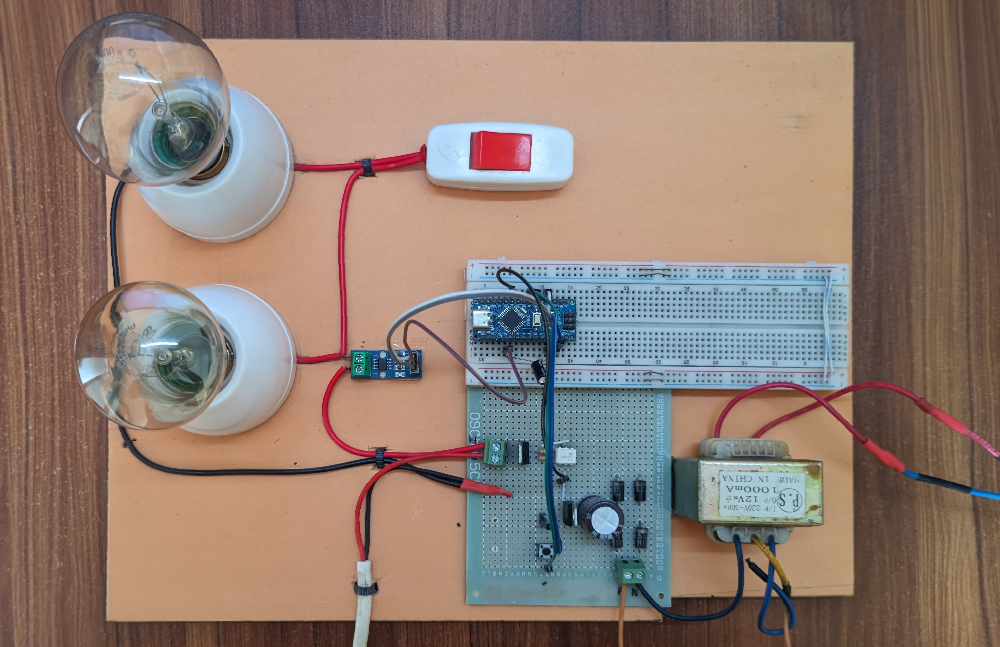
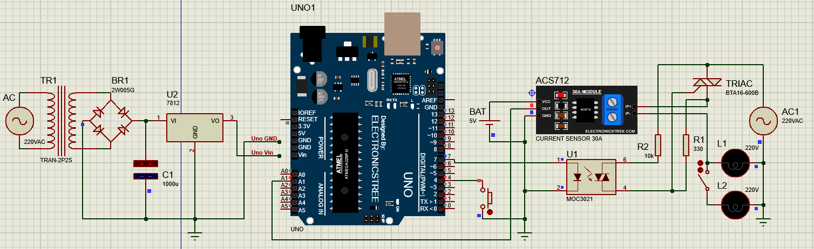

# Automatic Overcurrent Protection System using Arduino

An Arduino-based AC overcurrent protection prototype built for **EEE-4706: Power Electronics Sessional**, Department of EEE, International Islamic University Chittagong (IIUC).

The system measures load current with an ACS712-30A sensor, estimates RMS current, and disables the MOC3021/BTA16-600B switching stage when the filtered current exceeds **0.5 A**. The trip state stays latched until the reset button is pressed.

## Project overview

| Parameter | Implementation |
| --- | --- |
| Current sensor | ACS712, 30 A variant |
| Sensor sensitivity in firmware | 0.066 V/A |
| Trip condition | Filtered RMS current > 0.5 A |
| Reset | Push button, active LOW |
| Power switching | MOC3021 optotriac driver and BTA16-600B TRIAC |
| Reported supply | 220 V AC, 50 Hz |
| Serial monitor | 9600 baud |

## Circuit

[Original circuit screenshot](assets/images/circuit-screenshot.png)

## Pin assignments

| Arduino pin | Connection | Behavior |
| --- | --- | --- |
| A1 | ACS712 analog output | Current-sensor input |
| D7 | MOC3021 control input through the circuit's input stage | HIGH during normal operation; LOW when tripped |
| D4 | Reset push button to GND | `INPUT_PULLUP`; pressing the button clears the latch |

Use the complete circuit diagram for power connections and component wiring.

## Firmware

Open [Overcurrent_Protection.ino](firmware/Overcurrent_Protection/Overcurrent_Protection.ino) in Arduino IDE. Select the board and port matching your hardware, upload the sketch, and open Serial Monitor at **9600 baud**. The code assumes a **5 V ADC reference and a 10-bit ADC**; verify these match your board.

The sketch is a byte-for-byte copy of the supplied [original firmware text](firmware/Overcurrent_Protection_2.txt), with an Arduino-compatible filename. No external libraries are referenced.

Each loop averages 100 samples to estimate the sensor offset, then takes another 100 samples to estimate RMS current. A low-pass filter applies `0.9 * previous + 0.1 * measured`. The filtered value drives the trip decision.

Pressing D4 clears the latch with a 300 ms delay. The original code checks reset after its trip check, so holding reset can temporarily keep the output enabled even when an overcurrent condition persists. Startup also enables D7. These behaviors are preserved from the submitted firmware.

## Demonstration

[Watch/download the demonstration video](assets/video/demo.mp4)

The project report describes a 60 W bulb operating at approximately **0.3 A**, then a parallel 60 W + 100 W load reaching approximately **0.78 A** and triggering protection. These are the report's observations; this package does not add new measurements or a verified trip-time specification.

## Documentation

- [Project report](docs/Project-Report.pdf)
- [OCP project approval](docs/Project-Approval.pdf)
- [Code explanations](docs/Code-Descriptions.pdf)
- [Source and packaging notes](docs/SOURCE-NOTES.md)

## Project team

| Name | Matric ID |
| --- | --- |
| Imran Yakub | ET231035 |
| Md. Sayem-Ur-Rahman | ET231037 |

**Course:** EEE-4706, Power Electronics Sessional  
**Semester:** 7th, Spring 2026; Section 7A  
**Submitted to:** Md. Rasheduzzaman, Associate Professor, Department of EEE, IIUC

## Scope

This repository documents an academic hardware prototype. The original firmware and report are preserved with the packaging changes recorded in the source notes. Firmware compilation and hardware operation have not been independently verified for this ZIP.
